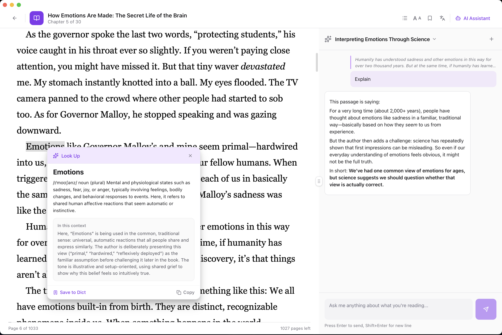

<!-- LOGO -->
<h1 align="center">
  
   
  Quill
</h1>

  Read a book. Bring your reading partner.
   
  An eBook reader with a built-in AI assistant — works with your ChatGPT subscription, API keys, or local models.

  <a href="#about">About</a>
  ·
  <a href="#download">Download</a>
  ·
  <a href="#demo">Demo</a>
  ·
  <a href="#ai-providers">AI providers</a>
  ·
  <a href="#documentation">Documentation</a>
  ·
  <a href="./CLAUDE.md">Contributing</a>

---

> Status: shipping on Mac, Windows, and iOS; library, progress, highlights, and settings sync across Mac, iPhone, and iPad via iCloud.

---

## About

Quill is what happens when you stop alt-tabbing between a reader and ChatGPT and put them in one window instead.

You open a book — EPUB or PDF, paginated or scrolled, the typography knobs you'd expect. You highlight a passage that confuses you and ask the assistant what's going on; your selection is the context, no copy-pasting. You tap a word and get a contextual definition you can save to a vocabulary deck with spaced repetition. You pick the model: OpenAI via OAuth (your existing ChatGPT subscription, no extra payment), Anthropic, any OpenAI-compatible endpoint, or Ollama running on your own machine.

Your library lives in iCloud, so the book you started on the Mac picks up on the iPhone or iPad — same progress, same highlights, same notes. The desktop app is built on Electron, React, foliate-js, and a Rust core (`quill-core`); the iOS app is native SwiftUI on top of the same renderer.

## Download

Latest installers on the [releases page](https://github.com/yicheng47/quill/releases/latest) (or preview builds from the rolling [`nightly` prerelease](https://github.com/yicheng47/quill/releases/tag/nightly)):

### macOS

| File | Platform |
| --- | --- |
| `Quill-x.x.x-arm64.dmg` | Apple Silicon (M1/M2/M3/M4) |
| `Quill-x.x.x-x64.dmg` | Intel Mac |

Open the `.dmg` and drag **Quill.app** to your Applications folder. Upgrading from `1.x` to `2.0.0` is a one-time manual download because the desktop shell moved from Tauri to Electron; existing library data, settings, iCloud sync state, and MCP configurations are preserved automatically.

### Windows

| File | Platform |
| --- | --- |
| `Quill-Setup-x.x.x-x64.exe` | Windows 10/11 (x64, unsigned NSIS installer) |

Upgrading from `1.x` to `2.0.0` is a one-time manual installer download.

### iOS

[Quill on the App Store](https://apps.apple.com/us/app/quill-ai-book-reader/id6762075206) — iPhone and iPad. Signs in to the same iCloud account as the Mac app to keep your library in sync.

## Demo

https://github.com/user-attachments/assets/b0bcbe54-de4b-4ea8-b4c9-b0c4346eda40

## Screenshots

<table>
  <tr>
    <td width="50%"></td>
    <td width="50%"></td>
  </tr>
  <tr>
    <td align="center"><em>Library — grid/list, search, status filters, collections</em></td>
    <td align="center"><em>Reader — AI assistant + word lookup inline with the text</em></td>
  </tr>
</table>

## What it does

- **Reading** — EPUB and PDF, paginated or scrolled, customizable fonts/spacing/margins, color-coded highlights with notes, bookmarks.
- **AI assistant** — ask about any passage with your highlight as context; word lookup for instant definitions or deep explanations.
- **Vocabulary** — save words with the sentence they came from, track mastery with spaced repetition.
- **Library** — grid and list views, search, status filters, collections.
- **iCloud sync** — books, progress, highlights, vocabulary, and settings sync across Mac, iPhone, and iPad.

## AI providers

Configure in Settings:

| Provider | Setup |
| --- | --- |
| **OpenAI (OAuth)** *(default)* | Sign in with your OpenAI account — uses your existing ChatGPT subscription, no API key or extra payment |
| **Ollama** | Install [Ollama](https://ollama.com/), `ollama pull llama3.2`, no API key |
| **OpenAI (API key)** | Add your OpenAI API key (pay-per-use) |
| **Anthropic** | Add your Anthropic API key |
| **OpenAI-compatible** | Pick the OpenAI provider, switch auth to API key, point Base URL at any compatible endpoint |

## Documentation

Feature specs, implementation plans, and the roadmap live in [`docs/`](./docs/):

- [`docs/features/`](./docs/features/) — specs of features in development
- [`docs/impls/`](./docs/impls/) — implementation plans paired with each feature
- [`docs/roadmap/`](./docs/roadmap/) — milestones (MVP, depth, companion)
- [`docs/guide/`](./docs/guide/) — engineering guides
- [`docs/tests/`](./docs/tests/README.md) — validation scope, live regression cases and run records
- [`docs/privacy.md`](./docs/privacy.md) — privacy policy

For dev setup, tech stack, and conventions see the shared [agent guide](./AGENTS.md). Design sources live under `quill/desktop/` in the private `YeelinksCo/yeelinks_design` repo.

## License

[MIT](LICENSE)
