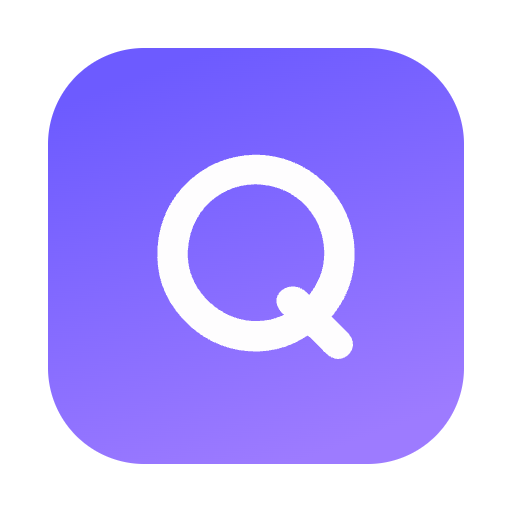
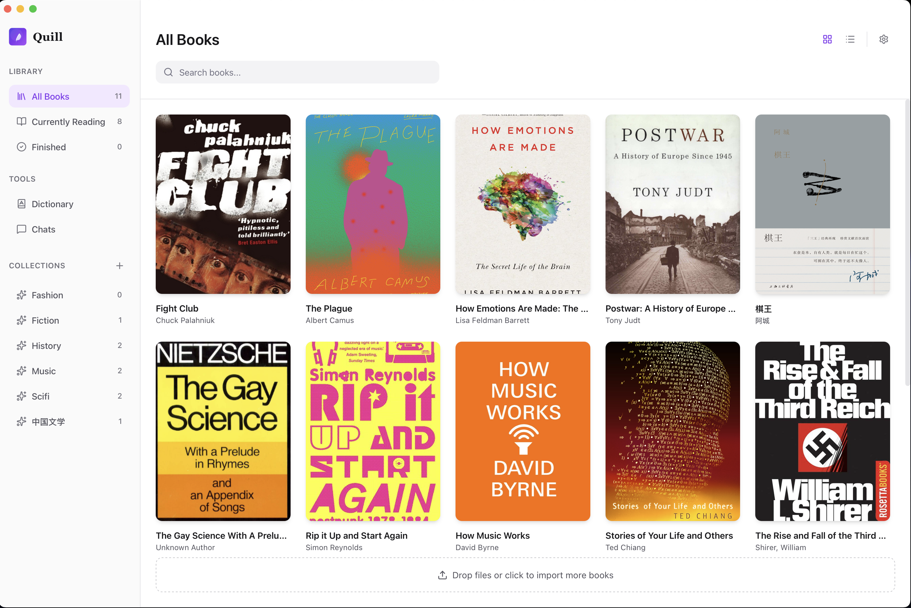

<!-- LOGO -->
<h1 align="center">
  
   
  Quill Reader
</h1>

  Trace your thoughts as you read
   
  A local-first ebook reader with native AI and agent integration — bring your own subscriptions, API keys, local models, or agents.

  <a href="#about">About</a>
  ·
  <a href="#download">Download</a>
  ·
  <a href="#demo">Demo</a>
  ·
  <a href="#ai-providers">AI providers</a>
  ·
  <a href="#documentation">Documentation</a>
  ·
  <a href="./CLAUDE.md">Contributing</a>

---

> Status: shipping on Mac, Windows, and iPhone. Older Mac builds with iCloud Sync in Settings (such as the `v1.3.4` stable release) sync with iPhone over iCloud; desktop builds on `main` from `#370` M1 onward (including current `2.0.0-nightly` and upcoming desktop releases) are local-only while Quill Cloud (#370) replaces legacy iCloud sync.

---

## About

Quill Reader is what happens when you stop alt-tabbing between a reader and ChatGPT and put them in one window instead.

You open a book — EPUB or PDF, paginated or scrolled, the typography knobs you'd expect. You highlight a passage that confuses you and ask the assistant what's going on; your selection is the context, no copy-pasting. You tap a word and get a contextual definition you can save to your vocabulary with the sentence it came from. You pick how it reaches a model: Codex, which uses the ChatGPT plan you already pay for, your own API key for OpenAI, Anthropic, Gemini, DeepSeek, OpenRouter or any OpenAI-compatible service, or Ollama running on your own machine.

Older Mac builds with iCloud Sync in Settings sync reading progress, highlights, and notes with iPhone via iCloud; desktop builds on `main` from `#370` M1 onward are local-only ahead of Quill Cloud (#370). The desktop app is built on Electron, React, foliate-js, and a Rust core (`quill-core`); the iOS app is native SwiftUI on top of the same renderer.

## Download

Latest installers on the [releases page](https://github.com/yicheng47/quill/releases/latest) (or preview builds from the rolling [`nightly` prerelease](https://github.com/yicheng47/quill/releases/tag/nightly)):

### macOS

| File | Platform |
| --- | --- |
| `Quill-x.x.x-arm64.dmg` | Apple Silicon (M1/M2/M3/M4) |
| `Quill-x.x.x-x64.dmg` | Intel Mac |

Open the `.dmg` and drag **Quill.app** to your Applications folder. Upgrading from `1.x` to `2.0.0` is a one-time manual download because the desktop shell moved from Tauri to Electron; existing library data, settings, API keys, and MCP configurations are preserved automatically. If you signed in with ChatGPT in `1.x`, `2.0.0` reaches your plan through Codex instead and walks you through connecting it on first launch.

> **Upgrading from an older Mac build with iCloud Sync enabled to a local-only desktop build (`#370` M1 / current `2.0.0-nightly` and upcoming releases):** Legacy iCloud sync has been removed from desktop builds on `main` ahead of Quill Cloud (#370), and these builds open only local app data without copying files back from iCloud Drive. Before installing a local-only build on a Mac where iCloud Sync is enabled, open your existing Mac build that still has Library Sync in Settings (for example `v1.3.4` or an earlier pre-`#370` M1 nightly), turn off sync, wait for the local copy to finish, and verify a book opens before replacing the app.

### Windows

| File | Platform |
| --- | --- |
| `Quill-Setup-x.x.x-x64.exe` | Windows 10/11 (x64, unsigned NSIS installer) |

Upgrading from `1.x` to `2.0.0` is a one-time manual installer download.

### iOS

[Quill Reader for iPhone](https://apps.apple.com/us/app/quill-ai-book-reader/id6762075206) on the App Store. Sign in to the same iCloud account as an older Mac build with iCloud Sync in Settings (such as `v1.3.4`) to sync over iCloud; local-only desktop builds on `main` (from `#370` M1 onward) do not sync with iPhone until Quill Cloud (#370) ships.

## Demo

https://github.com/user-attachments/assets/b0bcbe54-de4b-4ea8-b4c9-b0c4346eda40

## Screenshots

<table>
  <tr>
    <td width="50%"></td>
    <td width="50%"></td>
  </tr>
  <tr>
    <td align="center"><em>Library — grid/list, search, status filters, collections</em></td>
    <td align="center"><em>Reader — AI assistant + word lookup inline with the text</em></td>
  </tr>
</table>

## What it does

- **Reading** — EPUB and PDF, paginated or scrolled, customizable fonts/spacing/margins, paper, sepia and dark page themes, color-coded highlights with notes, bookmarks.
- **AI assistant** — ask about any passage with your selection as context; look up a word, explain a passage or translate it inline. Conversations stay in Chats, linked back to the passage.
- **Vocabulary** — save words with the sentence they came from and browse them across books.
- **Library** — Home, grid and list views, status filters, collections, and one search across books, highlights, words, and chats.
- **Sync (transitioning)** — older Mac builds with iCloud Sync in Settings (such as `v1.3.4`) and the iPhone app sync via iCloud; desktop builds on `main` from `#370` M1 onward are local-only while legacy iCloud sync is replaced by Quill Cloud (#370).
- **Agent integration** — a local MCP server lets Claude Code, Codex, and other MCP clients read your library, highlights, vocabulary, and chats, and manage books and collections when you allow it.

## AI providers

Configure in Settings → AI Assistant. Chat, look-up, explain, and translate can each use a different model.

| Connection | Setup |
| --- | --- |
| **Agent: Codex** *(recommended)* | Uses the ChatGPT plan you already pay for. Install Codex and sign in with ChatGPT; Quill stores no OpenAI tokens of its own |
| **API: OpenAI, Anthropic, Gemini, DeepSeek, OpenRouter** | Add your API key (pay-per-use). Keys stay on this computer and never sync |
| **API: Ollama** | Install [Ollama](https://ollama.com/) and pull a model, no API key |
| **API: Custom** | Point it at any OpenAI-compatible endpoint |

## Documentation

Feature specs, implementation plans, and the roadmap live in [`docs/`](./docs/):

- [`docs/features/`](./docs/features/) — specs of features in development
- [`docs/impls/`](./docs/impls/) — implementation plans paired with each feature
- [`docs/roadmap/`](./docs/roadmap/) — milestones (MVP, depth, companion)
- [`docs/guide/`](./docs/guide/) — engineering guides
- [`docs/tests/`](./docs/tests/README.md) — validation scope, live regression cases and run records
- [`docs/privacy.md`](./docs/privacy.md) — privacy policy

For dev setup, tech stack, and conventions see the shared [agent guide](./AGENTS.md). Design sources live under `quill/desktop/` in the private `YeelinksCo/yeelinks_design` repo.

## License

[MIT](LICENSE)
