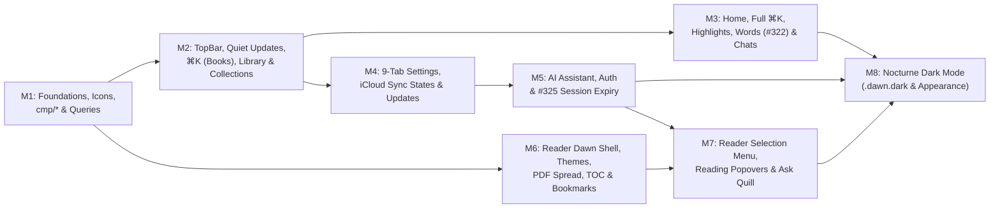

# 331 — Desktop Rebrand Implementation Plan

Program record: [`README.md`](README.md). Spec: [`docs/features/331-rebrand.md`](../../features/331-rebrand.md). Design & token map: [`design-map.md`](design-map.md). Implementation log: [`impl_log.md`](impl_log.md). Regression suite: [`docs/tests/regression/`](../../tests/regression/README.md).

## Delivery Model

- **Direct-to-`main` staged missions.** Every mission branches from `origin/main` in `.worktrees/feat-331-m<N>-<slug>` (M1 uses `.worktrees/feat-331-rebrand` / PR [#332](https://github.com/yicheng47/quill/pull/332)), opens a focused PR against `main`, passes code review, live QA, and macOS/Windows CI, and merges into `main` via `gh pr merge --merge`.
- **Clean boundaries after every merge:**
  - **M1** adds Dawn CSS tokens scoped under `.dawn` (inactive on `<html>`), keeps existing `windows.ts` titlebar heights, and lands Lens Q icons, bundled fonts, `cmp/*` primitives, and read-only Rust highlight/unread queries.
  - **M2** activates `.dawn` on `isMainWindow` (`71px` titlebar), replaces `Sidebar.tsx` + `UpdateToast.tsx` with `TopBar` (`pL47g`: live routes `Library`, `Words`, `Chats` until M3), adds the quiet 24px `$accent` update indicator + `Ready` popover, ships `⌘K` Command Search (`Books` scope in M2), and rebuilds `Library` (Grid/List, iCloud download state, end-to-end `Collections` & `Add Books` picker, and separated import overlays/toast).
  - **M3** activates all 5 `TopBar` tabs (`Home` default), expands `⌘K` Command Search across `All · Books · Highlights · Words · Chats`, and ships `Home` (bento + first-launch specimen empty state), `Highlights`, `Words` (#322), and `Chats` with all filter, inline-edit, delete, and empty states.
  - **M4** replaces `SettingsModal.tsx` with the 9-tab in-window `Settings` view (`cmp/SettingsNav` `eY7n3`: `APP · AI · INTEGRATIONS · SYSTEM`), shipping `General` (excluding `#276` `DATA` reset), `Appearance` (`Light` active, `System`/`Dark` disabled until M8), `Reading`, `Tools`, the complete `iCloud Sync` UI state machine, `MCP`, `Updates` (6 hero states + cancellation/skip IPC), and `About`, while mounting existing `AiSettings` inside `AI Assistant` until M5.
  - **M5** ships the redesigned `AI Assistant` & `AI Auth` lifecycle plus `#325` (`AI_REAUTH_REQUIRED` backend classification, stream plumbing, `openai_oauth_cancel`, Ollama ping, and re-auth cards).
  - **M6** activates `.dawn` on `Reader` windows (`64px` titlebar), shipping Paper/Sepia/Gray/Dark/PDF-spread surfaces, `Progress pill` + jump-back pill, `Typography` (`Aa`) popover, `Contents` island, `Highlights / Bookmarks` island + inline highlight toolbar, and `Book in iCloud` while keeping existing AI popovers and `AiPanel` functional until M7.
  - **M7** completes the Reader rebrand with `Selection Menu`, `Look Up` / `Explain` / `Translate` popovers, `Words in Book` island, and `Ask Quill` island + thread switcher.
  - **M8** ships **Nocturne Dark Mode** (`.dawn.dark` token variables, `Appearance` `System` / `Light` / `Dark` activation, `BrowserWindow` dark background sync, and cross-surface dark verification).
- **Crews & design refs.** Confirm the crew with Jason before each mission start (`claude trio` default for live-checked UI missions unless Jason specifies `codex` or `hydrogen`). The design source is `quill/desktop/specs/331-rebrand.pen`; crews read its frames through the Pencil MCP by the node IDs in [`design-map.md`](design-map.md), exporting to their own scratch directory when a reference image helps.

---

## Phase 1 — Foundations & Main Shell

### Mission 1 — Dawn Foundations, Brand Icons, `cmp/*` Primitives & Highlight Queries (`331-m1-foundations`)

- **Branch / PR:** `feat/331-rebrand` in `.worktrees/feat-331-rebrand` → PR [#332](https://github.com/yicheng47/quill/pull/332) (`risk-medium`), merged 2026-11-18.
- **Pencil nodes:** `t405CC`, `Owck6` (`YJzBT`, `Qn3yN`, and core `cmp/*` controls; `cmp/SettingsNav` `eY7n3` lands in M4).
- **Deliverables:**
  1. Replace `build/icons/*` (`.icns`, `.ico`, PNGs), `assets/icon.png`, and `src/components/QuillLogo.tsx` with the Lens Q mark (`YJzBT.svg` / `Qn3yN.svg`), plus window icon wiring in `electron/main/`.
  2. Bundle offline `Geist`, `Geist Mono`, and `Literata` fonts and add Dawn CSS variables/utilities in `src/index.css` scoped under `.dawn` so existing screens remain untouched until M2. Keep `electron/main/windows.ts` titlebar heights at `44px` (`main`) and `32px` (`reader-*`).
  3. Build the core `cmp/*` UI primitives under `src/components/ui/`: `Button`, `IconButton`, `Segment`, `Chip`, `SearchField`, `TextField`, `Select`, `ProgressBar`, `Badge`, `BookCover`, `Menu`, `Switch`, `Stepper`, `Tile`, and `SettingsRow`, with unit tests.
  4. Add `BookCounts.unread` in `crates/quill-core/src/commands/books.rs` and read-only `list_all_highlights` + `get_highlight_counts` in `crates/quill-core/src/commands/bookmarks.rs` + `dispatch.rs`, with Rust unit and dispatch parity tests.
- **Gate:** Workspace Rust/TS/lint/Vitest/unpacked-pack checks + live QA (`APP-01`, `LIB-01`, `RDR-01`, `F-331-ICON`).

### Mission 2 — `TopBar`, Quiet Updates Indicator, `⌘K` (Books), `Library` & Collection Flows (`331-m2-topbar-and-library`)

- **Branch:** `feat/331-m2-topbar-and-library` (`risk-high`, `needs-live-test`).
- **Pencil nodes:** `pL47g`, `Rh6Ai` (left half), `tcZmU` (`yMmME` TopBar sync chip), `CjQ94` (Books scope), `BC0DA`, `BUxUo`, `J6aW1P`, `RhsF8`, `A03E8`, `Zzvta`, `F7B1gQ`, `r532a5`.
- **Deliverables:**
  1. **Backend collection membership query:** Add `list_book_collections(book_id)` (and optional `add_books_to_collection(collection_id, book_ids)` helper) in `crates/quill-core/src/commands/collections.rs` + `dispatch.rs` with Rust unit tests so `BookContextMenu` (`F7B1gQ`) renders multi-collection checkmarks and `Add Books Picker` (`r532a5`) populates a collection cleanly.
  2. **Dawn main shell & `TopBar` (`pL47g`):** Activate `.dawn` on `isMainWindow` (`src/App.tsx`, keeping `.dark` reader-only until M8) and update `"main"` in `electron/main/windows.ts` (`baseHeight = 71`, `x = 28 * zoom`, `MAIN_DAWN_BG = "#EEEBF8"`). Replace `Sidebar.tsx` and `UpdateToast.tsx` with `TopBar.tsx`:
     - Left: traffic-light spacer + `QuillLogo` (`28px`) + `"Quill"` + TopBar sync `%` chip (`tcZmU` / `yMmME` during replay/rebuild) + quiet 24px `$accent` violet update indicator (`Rh6Ai` / `ArdQm`: hidden when up to date; `Available` click starts download immediately; `Downloading`/`Verifying` show non-interrupting progress/spinner; **only `Ready` opens the 264px popover** with open-reader count, `Restart to update`, `What's new`, `Later`; `Failed` opens Settings). Add open `reader-*` window count IPC in `electron/main/windows.ts` + `ipc.ts`.
     - Center: frosted pill nav showing active routes (`Library`, `Words`, `Chats` in M2; `Home` and `Highlights` turn on in M3).
     - Right: `Search` (`HSHBm` → opens `⌘K` Command Search Palette `CjQ94` scoped to `Books` in M2; `⌘F` focuses inline Library filter when on `Library`), `Import` (`CG99X`), and `Settings` (`qPeyq` / `⌘,`, opening existing `SettingsModal` until M4).
  3. **`Library` Grid, List & iCloud state (`RhsF8`, `A03E8`):** `4px` top body padding + `28px` header (`Library` + `<N> books`), `All / Reading / Finished / Unread` count segments, `Collections` pill trigger, `Grid / List` toggle, 6-up `BookCard` grid (`RhsF8`), rich `List` container (`A03E8` with collection chips, description, pages, progress bar, `Finished` check, and undownloaded iCloud book row with `Download from iCloud` pill + cloud badge), and infinite scroll.
  4. **End-to-end Collections & Book actions (`Zzvta`, `F7B1gQ`, `r532a5`):**
     - `Collections` popover (`Zzvta`, `r532a5` Col 1): `All books`, drag-to-reorder (`⋮⋮`) collections with counts, inline rename (`Enter`/`Esc`), non-destructive `Delete Collection` confirmation modal (`LhVoH` noting books stay in `All books`), and inline `NEW COLLECTION` creation form (`ZTS5T`).
     - Active collection view (`Zzvta`, `r532a5` Col 2): `+ Add Books` header pill, empty-collection card (`iOMsq`: `Add Books from Library…` + `Import File…`), and multi-select `Add Books Picker Modal` (`PCIT1`).
     - `BookContextMenu` (`F7B1gQ`) + cascading `Add to Collection` submenu (`aoADt`: multi-collection checkmarks + inline `+ NEW COLLECTION & ADD BOOK` row `WlcB8`), Dawn `Edit Book Info` modal (`b4om2`), `Delete Book` confirmation modal (`MQihI`), and no-match filter state (`ig0MO`).
  5. **Separated Import states (`BC0DA`, `BUxUo`, `J6aW1P`):** Separate centered `Drop books to add to Quill` overlay (`BC0DA`), centered `Importing…` spinner card with `>5s` slow-PDF hint (`BUxUo`), and top-center non-blocking `Couldn't import book` error toast (`J6aW1P`).
  6. Sync `en.json` and `zh.json`.
- **Gate:** `APP-01`..`APP-04` (traffic lights & drag region at 100% and zoomed), `LIB-01`..`LIB-03`, `LIB-05`..`LIB-09`, `RDR-08`, plus `F-331-UPD-TOPBAR` and `F-331-COLLECTIONS` (create collection → populate via `Add Books` picker → multi-collection context-menu toggle → non-destructive delete).

---

## Phase 2 — Main Window Views, Settings & Auth

### Mission 3 — `Home` Bento, Full `⌘K` Search, `Highlights`, `Words` (#322) & `Chats` (`331-m3-main-views`)

- **Branch:** `feat/331-m3-main-views` (`risk-medium`, `needs-live-test`; closes [#322](https://github.com/yicheng47/quill/issues/322)).
- **Pencil nodes:** `m2srt`, `XkjMq` (`OqN9H`), `CjQ94`, `eKFrn`, `zWiKF`, `SiLV6`, `JSI0p`, `rylLh`, `A4GWjG`, `l6BCnh`, `DjXY3`, `ETt8K`, `BsJqG`, `S4d1bF`, `y4fAJ`.
- **Deliverables:**
  1. Enable all 5 `TopBar` tabs (`Home · Library · Highlights · Words · Chats`) with `Home` as default, and expand `⌘K` Command Search (`CjQ94`) across all 5 scope chips (`All · Books · Highlights · Words · Chats`) with keyboard navigation (`↑↓`, `↵`, `⌘↵`, `Tab`, `Esc`).
  2. **`Home` (`m2srt`, `XkjMq` / `OqN9H`):** Populated bento (`Now reading` with progress %, `~1.5 min/page` estimate when `pages > 0`, latest highlight, `Continue reading`, `Ask about this part`; `Saved words` count + 6 chips → `Words`; `Last conversation` → `Chats`; `Library` 5-cover shelf; `Also reading` + `Collections` chips → filtered `Library`), plus the first-launch 0-books view (`XkjMq`) with `Import Your First Book` / `Turn On iCloud Sync…` and the 3 tactile specimen cards (`OqN9H`: `I4cPVe`, `Gh64n`, `f6Yyeq`).
  3. **`Highlights` (`eKFrn`, `zWiKF`, `SiLV6`, `JSI0p`):** Left book rail (`All highlights` + per-book counts), book-scoped view (`eKFrn`) and cross-book stream (`zWiKF`), 4-color swatch filter pill + `Filter highlights…` search, `Sort` popover (`Newest first`, `Oldest first`, `Book chapter order` in `SiLV6`), hover action bar (recolor dots, `Edit note`, `Copy`, `Open`, `Delete`), inline margin-note editor (`Xh0Fy` via `update_highlight_note`), `Remove this highlight & note?` popover (`utGLD`), and empty state (`JSI0p`).
  4. **`Words` (`rylLh`, `A4GWjG`, `l6BCnh`, `DjXY3`, closes #322):** Master-detail view supporting both month-grouped (`Newest`/`Oldest`, `rylLh`) and `A–Z` alphabetical (`A4GWjG`) list modes, `All books` count popover (`E5Ldme`), search prefix filter + no-match state (`l6BCnh`), inline detail pane (`MEANING`, `IN CONTEXT` paper card + `Go to passage`, `IN THIS PASSAGE`), 3-second 2-click `Click again to delete` confirmation pill (`jsJ47`), and empty state (`DjXY3`).
  5. **`Chats` (`ETt8K`, `BsJqG`, `S4d1bF`, `y4fAJ`):** Month-grouped left list with infinite scroll, `All books` count popover (`u1nC3`), inline header title rename (`WCcae`), `Thread More Menu` (`SGaEg`: `Rename conversation`, `Open in book`, `Copy as Markdown`, `Delete conversation…`), `Generating title…` header spinner (`f5BTo`), `Delete conversation?` confirmation modal (`u68JKl`), passage quote + streaming composer, and empty state (`y4fAJ`).
  6. Sync `en.json` and `zh.json`.
- **Gate:** `VOC-01`, `AI-05` (inline streaming reply on inexpensive model), `RDR-01` (deep links from Home/Highlights/Words/Chats and `⌘K` to Reader), `F-331-HOME`, `F-331-CMDK`, and `F-331-HL`.

### Mission 4 — 9-Tab In-Window `Settings`, `iCloud Sync` States, `Updates` & `About` (`331-m4-settings-and-updates`)

- **Branch:** `feat/331-m4-settings-and-updates` (`risk-medium`, `needs-live-test`).
- **Pencil nodes:** `eY7n3`, `xEUTG`, `dkFHc` (section 1 only), `MR9Fc`, `a1k3n`, `qbLwo`, `HUr9u`, `MpBgt`, `stXkC`, `tcZmU`, `t47BM`, `HnSex`, `Rh6Ai` (right half), `TL2Mh`.
- **Deliverables:**
  1. Replace `SettingsModal.tsx` with the in-window `Settings` view under `TopBar` (gear `qPeyq` takes `$accent-tint` active state; `⌘,` toggles; `Esc` or clicking any `TopBar` route exits; cross-window `open-settings` routes to all 9 sections including `"updates"`).
  2. Wire `cmp/SettingsNav` (`eY7n3`) with 4 uppercase groups (`APP`: `General`, `Appearance`, `Reading`; `AI`: `AI Assistant`, `Tools`; `INTEGRATIONS`: `iCloud Sync` on macOS, `MCP`; `SYSTEM`: `Updates`, `About`) and centered `720px` right-pane columns (`22px` section headers).
  3. Rebuild `General` (`xEUTG` + `dkFHc` inline `Display name` edit + `Interface language`; omit `#276` `DATA` reset card until `#276` ships), `Appearance` (`MR9Fc`: `Light` active, `System`/`Dark` disabled until M8, `App zoom` stepper), `Reading` (`a1k3n`: theme swatches, `Literata` added to font select, steppers, margins, auto-save), `Tools` (`qbLwo`), and `MCP` (`t47BM`). Mount existing `AiSettings` cleanly inside `AI Assistant` until M5.
  4. **Complete `iCloud Sync` UI state machine (`HUr9u`, `MpBgt`, `stXkC`, `tcZmU`):** Re-skin `LibrarySyncSettings.tsx` onto Dawn cards and modals while preserving every sync/storage invariant untouched (no backend `crates/quill-core/src/sync/` edits):
     - Healthy synced (`HUr9u`): `Synced` status badge, `Compact log`, `Sync now`, cross-platform `DEVICES` card (`This Mac` pill, peer pending-events badge, peer trash), local-keys/merge note, and `REPAIR` (`Rebuild from iCloud`).
     - Local-only `Off` & `!available` macOS signed-out (`MpBgt`): off toggle + merge note, and disabled toggle + amber System Settings hint strip when `!available`.
     - Queue-only offline `Paused` & error (`stXkC`): durable `sync_enabled` keeps toggle **ON** while engine shows `Paused` (`Compact log`, `Sync now`, and `Rebuild` disabled), failed binary-move error banner with idempotent `Retry` (`lastFailedAction`), and manifest-cached offline `DEVICES`.
     - Active progress & modals (`tcZmU`): active replay progress card + `Cancel sync`, single-device empty peers card (`J7RzUE`), `Turn on`/`Turn off` confirmation modals, blocking non-dismissible `Copying library to this Mac…` phase/progress/file modal (`gFwqY`), and Cancel-focused `Remove Device` + `Rebuild Library` destructive modals.
  5. **`Updates` (`HnSex` + `Rh6Ai` right half) & `About` (`TL2Mh`):** Extend `electron/main/updater.ts` + `ipc.ts` + `UpdateContext.tsx` with `cancelUpdateDownload()` (`CancellationToken`), `skipped_update_version`, `last_update_check_at`, byte progress, and open-books count across all 6 hero states; build `About` with version + platform pill (`macOS · arm64` / `Windows · x64`), `DIAGNOSTICS` (`Reveal in Finder` / Explorer), and `LINKS & LICENSE`.
  6. Sync `en.json` and `zh.json`.
- **Gate:** `SET-01`, `SET-03`, `APP-03`, `MCP-01` (with `~/.claude.json` and `~/.codex/config.toml` `quill` entries backed up and restored verbatim), `F-331-UPD-SETTINGS`, and component/unit tests covering all `LibrarySyncSettings` states (`Off`, `!available`, `Paused`, `Error + Retry`, `Syncing`, `Copying locally`, `Remove peer`, `Rebuild`) with live iCloud sync kept **off** in `make dev`.

### Mission 5 — `AI Assistant` Redesign, Auth Lifecycle & `#325` Session Expiry (`331-m5-ai-assistant-and-auth`)

- **Branch:** `feat/331-m5-ai-assistant-and-auth` (`risk-medium`, `needs-live-test`; closes [#325](https://github.com/yicheng47/quill/issues/325)).
- **Pencil nodes:** `k9Vj9`, `XIfpn`, `lXiaG`, `o04NH`.
- **Deliverables:**
  1. **Backend (`#325` + OAuth cancel + Ollama ping):** Implement [`docs/features/325-oauth-session-expiry.md`](../../features/325-oauth-session-expiry.md) in `crates/quill-core/src/ai/` (`AI_REAUTH_REQUIRED` on empty refresh token, refresh `400`/`401`, or Codex `401`, clearing tokens and emitting bare `AI_REAUTH_REQUIRED` across all 5 stream handlers while leaving network/`5xx`/`403` untouched); add `openai_oauth_cancel` in `commands/oauth.rs` + `ai/oauth.rs`; expose account email/identifier in `OAuthStatus` when available; add lightweight local Ollama reachability check (`Running` badge).
  2. **Frontend (`Settings — AI Assistant` & Auth cards):** Rebuild `AiSettings.tsx` across `k9Vj9` (Connected), `XIfpn` (Signed out), `lXiaG` (API Key + `Saved` + `Clear` + `Temperature`), and `o04NH` (`Waiting for browser sign-in…` + `Cancel`, `Couldn't complete sign-in` + `Try again`, `Ollama` card + `Keep model in memory`, `Sign out` confirmation dialog), plus Dawn `AI_REAUTH_REQUIRED` / `AI_NOT_CONFIGURED` prompt cards in `MessageBubble` and Reader popovers routing to `Settings → AI Assistant`.
  3. Sync `en.json` and `zh.json`.
- **Gate:** `AI-06` (testing sign-out and `#325` dead-refresh-token flow against a backed-up and restored `secrets.db`), `AI-07`, and `#325` unit/live checks.

---

## Phase 3 — Reader Surface & Reading AI

### Mission 6 — Reader Dawn Shell, Themes, PDF Spread, Navigation Islands & iCloud State (`331-m6-reader-shell`)

- **Branch:** `feat/331-m6-reader-shell` (`risk-high`, `needs-live-test`; eligible any time after **M1** merges).
- **Pencil nodes:** `yvlbP`, `U3KZf8`, `pB71W`, `GWA41` (right half), `Zd3OK`, `N4bEY` (left half), `ZKLDp`, `IjTTv`.
- **Deliverables:**
  1. Activate `.dawn` on `Reader` windows and update `"reader-*"` in `electron/main/windows.ts` (`baseHeight = 64`, `x = 28 * zoom`).
  2. **64px Toolbar, Floating Paper Island & `Progress pill` (`yvlbP`, `Zd3OK`, `N4bEY`, `ZKLDp`):** Left cluster (`<` `Back to Library` + `Contents` + title/chapter); right cluster (`Aa`, `Bookmarks/Highlights`, `Translate`, `Ask`); Paper island (`Original` `#FDFCFA`, `Sepia` `#F4ECD8`/`#EFE6D5`, `Gray`, `Dark` `#1E1D24`/`#1B1B1F`) for EPUB and single/two-page sheet layout for PDF (`ZKLDp`); floating EPUB `Progress pill` + `← Back to p. N` jump-back pill (`U3KZf8`) and `PDF Progress & Zoom Pill` (`EoKCM`).
  3. **`Typography` (`Aa`) Popover (`Zd3OK`, `ZKLDp`):** EPUB (`j9ODh`: font size slider, 4 theme swatches, `Literata` + font select, `Scrolling / Paginated` cards, line/character spacing steppers, margins) and PDF (`aCUa5`: theme swatches + `Single page / Two pages` spread toggle).
  4. **Navigation Islands & iCloud state (`U3KZf8`, `pB71W`, `GWA41`, `IjTTv`):** Left `Contents` glass island (`U3KZf8`), right `Highlights / Bookmarks` glass island (`pB71W`, `GWA41`) + inline 5-dot `HighlightToolbar` (`hxqCJ`), and `Book in iCloud` screen (`IjTTv`).
  5. **Page-theme reader shell (`luJ5A`, `Zd3OK`, `N4bEY`):** the toolbar and border follow the page theme (`Original` → Dawn, `Sepia` → `reader-shell-sepia-*`, `Gray` → `reader-shell-gray-*`, `Dark` → Nocturne via `.dawn.dark` values on the reader window), with the reader `BrowserWindow` background matched at creation and on theme switch.
  6. **Reader window placement:** new readers open near the main window on its display, cascading 32px diagonally per open reader and wrapping before overflow; placement maths in a tested pure function.
  7. Sync `en.json` and `zh.json`.
- **Gate:** `RDR-01`..`RDR-09`, `RDR-11`, `APP-04` (reader traffic lights & zoom), `F-331-READER-VISUAL` (all four page-theme shells) and `F-331-READER-PLACEMENT`.

### Mission 7 — Reader `Selection Menu`, Reading Popovers, `Words in Book` & `Ask Quill` (`331-m7-reader-ai-and-popovers`)

- **Branch:** `feat/331-m7-reader-ai-and-popovers` (`risk-medium`, `needs-live-test`).
- **Pencil nodes:** `ECLAp`, `rdcDH`, `xqqVr`, `ZpzpR`, `GWA41` (left half), `N4bEY` (right half), `o04NH` (state 5).
- **Deliverables:**
  1. **Inline `Selection Menu` (`rdcDH`):** `Look Up`, `Explain`, `Quote in Chat`, `Translate`, 5 highlight color dots, and `Copy ⌘C`.
  2. **Reading Popovers (`xqqVr`, `ZpzpR`, `GWA41`):** `LookupPopover` (`tS7gX`: POS badge, IPA, gloss, definition, `IN THIS PASSAGE`, `Save to Words` + `Copy`), `ExplainPopover` (`Z9ULVg`: passage quote, streaming markdown, `Quote in Chat` + `Copy`), and `TranslationPopover` (`t0TRJ`: target-language chip, source quote, streaming translation, `Show surrounding context` toggle + `Copy`).
  3. **`Words in Book` Island (`xqqVr` right half):** Right glass island (`N0gxbh`) with count badge, search, word cards, and `Open in Words →` deep link.
  4. **`Ask Quill` Island (`ECLAp`, `ZpzpR`, `N4bEY`):** Thread header + `Thread Switcher Dropdown` (`pp2Tt`), starter-prompts empty state (`ZpzpR`), dismissible `Pending Quote Chip` (`hPfVt`), streaming thread + follow-up chips, composer + model/effort footer, and `#325` re-auth / unconfigured cards (`o04NH`).
  5. Sync `en.json` and `zh.json`.
- **Gate:** `AI-01`..`AI-04`, `AI-07`, `VOC-01`.

---

## Phase 4 — Nocturne Dark Mode

### Mission 8 — Nocturne Dark Mode Across Main & Reader Shells (`331-m8-nocturne-dark-mode`)

- **Branch:** `feat/331-m8-nocturne-dark-mode` (`risk-medium`, `needs-live-test`; completes [#331](https://github.com/yicheng47/quill/issues/331)).
- **Pencil nodes:** `q62MgQ`, `Y803E5`, `T1qAJe`, `CPGY5` (token table in [`design-map.md`](design-map.md#3-dawn-light--nocturne-dark-semantic-tokens)).
- **Deliverables:**
  1. **Nocturne CSS token layer:** Add `.dawn.dark` semantic variable definitions in `src/index.css` matching the Nocturne dark axis in [`design-map.md`](design-map.md#3-dawn-light--nocturne-dark-semantic-tokens) (`#12111A` → `#17151F` gradient + twilight violet/ember/sea-glass radial glows, `#1E1D29CC` glass, `#232130` solid popovers/modals, `#1B1A23` dark paper, `#8477EE` accent, `#C8C0FF` `accent-on-tint`, translucent dark highlight swatches, and dark shadow overrides). M6 already defines these values for reader windows on the `Dark` page; M8 applies them to the main window.
  2. **Theme activation & flash-free window sync (`CPGY5`):** Enable `System`, `Light` (Dawn), and `Dark` (Nocturne) cards in `Settings → Appearance` (`CPGY5`, moving the active border and check badge onto the chosen mode), apply `.dark` alongside `.dawn` on the `main` window in `src/App.tsx` (reader windows keep following their page theme) (updating `App.theme.test.tsx`), and sync Electron `BrowserWindow.setBackgroundColor` (`#EEEBF8` vs `#12111A`) on boot and theme toggle in `electron/main/windows.ts` so neither window flashes white in Nocturne.
  3. **Reader page theme in Nocturne (`T1qAJe`):** reader windows follow their page theme from M6 on, so `T1qAJe` shows the `Dark` page case. Settle with Jason whether `Original` should follow the app theme while Nocturne is active.
  4. Sync `en.json` and `zh.json` (`Appearance` caption updated to *"Light is Dawn. Dark is Nocturne — both share the same semantic surface and accent tokens."*).
- **Gate:** `SET-01` (live `Light` ↔ `Dark` ↔ `System` switching across open Main + Reader windows without white flash on relaunch), plus `F-331-DARK` visual inspection across `Home` (`q62MgQ`), `Library` (`Y803E5`), `Highlights`, `Words`, `Chats`, `Settings` (`CPGY5`), and `Reader` (`T1qAJe`).

---

## Post-Ship Housekeeping

1. Remove `needs-design` on [#331](https://github.com/yicheng47/quill/issues/331) now that `f7cb448` is signed off; close [#322](https://github.com/yicheng47/quill/issues/322) on **M3** merge, [#325](https://github.com/yicheng47/quill/issues/325) on **M5** merge, and [#331](https://github.com/yicheng47/quill/issues/331) on **M8** merge.
2. Apply the shipped `#331` components and screens to `quill/desktop/quill-desktop.pen` in `YeelinksCo/yeelinks_design` and archive/prune redundant spec snapshots per `quill/desktop/README.md`.
