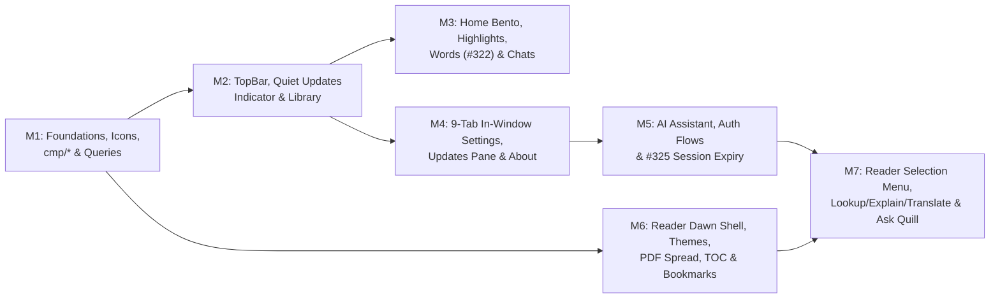

# 331 — Desktop Rebrand Implementation Plan

Spec: [`docs/features/331-rebrand.md`](../../features/331-rebrand.md). Issue: [#331](https://github.com/yicheng47/quill/issues/331) (also closes [#322](https://github.com/yicheng47/quill/issues/322) and [#325](https://github.com/yicheng47/quill/issues/325)). Design source: `quill/desktop/specs/331-rebrand.pen` in `YeelinksCo/yeelinks_design`. Regression suite: [`docs/tests/regression/`](../../tests/regression/README.md).

## Delivery Model (Direct-to-`main`, Staged Runner Missions)

- **No umbrella branch.** Every mission branches from `origin/main` in its own linked worktree `.worktrees/feat-331-m<N>-<slug>` (Mission 1 reuses `.worktrees/feat-331-rebrand` and PR [#332](https://github.com/yicheng47/quill/pull/332)), opens a focused pull request directly against `main`, clears code review, live QA, and macOS/Windows CI, and merges into `main` as a merge commit (`gh pr merge --merge`).
- **`main` stays shippable after every merge.** Each mission owns a clean DOM/window boundary and preserves working fallbacks for surfaces owned by later missions:
  - **M1** adds Dawn CSS tokens scoped under `.dawn` (not yet applied to `<html>`), keeps `electron/main/windows.ts` titlebar heights at `44px` (`main`) and `32px` (`reader-*`), and ships the Lens Q icons, bundled fonts, `cmp/*` primitives, and read-only Rust highlight/unread queries — zero visual regressions on existing screens.
  - **M2** activates `.dawn` on `isMainWindow`, updates `"main"` traffic lights to `71px` in `windows.ts`, swaps `Sidebar.tsx` + `UpdateToast.tsx` for `cmp/TopBar` (with the quiet 24px update indicator & `Ready` popover) and ships `Library`. Until M3 merges, `TopBar` renders only the live tabs (`Library`, `Words`, `Chats`), so `main` never exposes a dead tab.
  - **M3** ships `Home`, `Highlights`, `Words`, and `Chats`, enabling all 5 `TopBar` tabs with `Home` as default.
  - **M4** replaces `SettingsModal.tsx` with the 9-tab in-window `Settings` shell (`cmp/SettingsNav`: `APP · AI · INTEGRATIONS · SYSTEM`), shipping `General`, `Appearance`, `Reading`, `Tools`, `iCloud Sync`, `MCP`, `Updates`, and `About`, while mounting existing `AiSettings` inside the `AI Assistant` pane until M5.
  - **M5** ships the redesigned `AI Assistant` & `AI Auth` lifecycle plus `#325` (`AI_REAUTH_REQUIRED` backend classification + stream plumbing + prompt cards).
  - **M6** activates Dawn on `Reader` windows (`"reader-*"` traffic lights updated to `64px` in `windows.ts`), shipping the floating Paper/Sepia/Gray/Dark/PDF-spread surfaces, `Progress pill` + jump-back pill, `Typography` (`Aa`) popover, `Contents` island, `Highlights / Bookmarks` island + highlight toolbar, and `Book in iCloud` screen while keeping existing AI popovers and `AiPanel` working inside the new Reader shell until M7.
  - **M7** completes the Reader rebrand with `Selection Menu`, `Look Up` / `Explain` / `Translate` popovers, `Words in Book` island, and `Ask Quill` island.
- **Crews.** Visual UI missions default to **`hydrogen trio`** (`gemini-4-hydrogen` `xhigh` coder + `gpt-6.2-astra` `xhigh` reviewer + `gpt-6.2-sol` `high` QA); auth/backend-heavy M5 works equally well on **`hydrogen trio`** or **`codex trio`**. Confirm the crew with Jason before each mission start.
- **Design exports.** Because `.pen` files are encrypted, commit `quill/desktop/specs/331-rebrand.pen` in `YeelinksCo/yeelinks_design` first and export 2x PNGs + SVGs of all 30 frames to `/Users/jason/QuillQA/331/design-refs/<nodeId>.png` so `coder`, `reviewer`, and `qa` can inspect every frame directly alongside Pencil MCP.

---

## Complete Pencil Frame Inventory (`331-rebrand.pen`)

| Area | Node ID | Frame / Component | Owning Mission |
|---|---|---|---|
| Design System | `t405CC` | `331 / Design system — Foundations` | **M1** |
| Design System | `Owck6` | `331 / Design system — Components` (`cmp/*` controls incl. `YJzBT`, `Qn3yN`) | **M1** |
| Main Shell & Updates | `pL47g` | `cmp/TopBar` | **M2** |
| Main Shell & Updates | `Rh6Ai` (left) | `TopBar` 24px update indicator states & 264px `Ready` popover | **M2** |
| Main Views | `RhsF8` | `331 / Library` | **M2** |
| Main Views | `m2srt` | `331 / Home` | **M3** |
| Main Views | `eKFrn` | `331 / Highlights` | **M3** |
| Main Views | `rylLh` | `331 / Words` | **M3** |
| Main Views | `ETt8K` | `331 / Chats` | **M3** |
| Settings & Updates | `eY7n3` | `cmp/SettingsNav` (`APP · AI · INTEGRATIONS · SYSTEM`, 9 tabs) | **M4** |
| Settings & Updates | `xEUTG` | `331 / Settings — General` (`PROFILE` + `LIBRARY BACKUP`) | **M4** |
| Settings & Updates | `MR9Fc` | `331 / Settings — Appearance` (`Light` Dawn + `App zoom`) | **M4** |
| Settings & Updates | `a1k3n` | `331 / Settings — Reading` | **M4** |
| Settings & Updates | `qbLwo` | `331 / Settings — Tools` | **M4** |
| Settings & Updates | `HUr9u` | `331 / Settings — iCloud Sync` | **M4** |
| Settings & Updates | `t47BM` | `331 / Settings — MCP` | **M4** |
| Settings & Updates | `HnSex` | `331 / Settings — Updates` | **M4** |
| Settings & Updates | `Rh6Ai` (right) | `Settings → Updates` hero card states (`Checking`, `Available`, `Downloading`, `Ready`, `Failed`) | **M4** |
| Settings & Updates | `TL2Mh` | `331 / Settings — About` (`DIAGNOSTICS` + `LINKS & LICENSE`) | **M4** |
| AI & Auth (#325) | `k9Vj9` | `331 / Settings — AI Assistant` (ChatGPT Connected) | **M5** |
| AI & Auth (#325) | `XIfpn` | `331 / Settings — AI Assistant (Signed out)` | **M5** |
| AI & Auth (#325) | `lXiaG` | `331 / Settings — AI Assistant (API Key)` | **M5** |
| AI & Auth (#325) | `o04NH` | `331 / AI Auth — Browser Sign-in, Sign-out, Ollama & #325 Session Expiry` | **M5** (Settings + backend + Chats) & **M7** (Reader popovers) |
| Reader Shell | `yvlbP` | `331 / Reader — Chat closed` | **M6** |
| Reader Shell | `U3KZf8` | `331 / Reader — Contents` (+ `← Back to p. N` jump-back pill) | **M6** |
| Reader Shell | `pB71W` | `331 / Reader — Highlights & Toolbar` | **M6** |
| Reader Shell | `GWA41` (right) | `331 / Reader — Bookmarks Tab` | **M6** |
| Reader Shell | `Zd3OK` | `331 / Reader — Typography & Sepia Theme` | **M6** |
| Reader Shell | `N4bEY` (left) | `331 / Reader — Dark Page` (`#1B1B1F` paper + dark progress pill) | **M6** |
| Reader Shell | `ZKLDp` | `331 / Reader — PDF Spread & Zoom` | **M6** |
| Reader Shell | `IjTTv` | `331 / Reader — Book in iCloud` | **M6** |
| Reader AI & Popovers | `ECLAp` | `331 / Reader — Chat open` (`Ask Quill`) | **M7** |
| Reader AI & Popovers | `rdcDH` | `331 / Reader — Selection Menu` | **M7** |
| Reader AI & Popovers | `xqqVr` | `331 / Reader — Word Lookup & Book Words` | **M7** |
| Reader AI & Popovers | `ZpzpR` | `331 / Reader — Explain & Quote in Chat` | **M7** |
| Reader AI & Popovers | `GWA41` (left) | `331 / Reader — Translate Popover` | **M7** |
| Reader AI & Popovers | `N4bEY` (right) | `Ask Quill` Thread Switcher & Follow-up Chips | **M7** |

---

## Dawn Design System Reference (`t405CC`, `Owck6`)

- **Dawn atmosphere:** Linear `135deg` from `#ECE8FA` (`--color-bg-start`) to `#F7F1EE` (`--color-bg-end`), layered with three radial glows: violet `#CFC6FFE6` at `10% 5%` (`110% x 110%`), peach `#FFD3BDD9` at `95% 15%` (`90% x 90%`), and mint `#C6EADFD9` at `55% 105%` (`120% x 80%`).
- **Surfaces & elevation:**
  - `surface-glass`: `#FFFFFFB8` (`72%`), `1px solid #FFFFFFE6`, `backdrop-filter: blur(30px)`, shadow `0 10px 30px #3A2F6014`
  - `surface-inset`: `#FFFFFF99` (`60%`), `1px solid #15151A14`
  - `surface-chip`: `#FFFFFFCC` (`80%`)
  - `surface-solid`: `#FFFFFF`; `paper`: `#FDFCFA` (`paper-edge`: `#15151A0F`)
  - Menu shadow: `0 16px 40px #2A1F4D29`; Cover shadow: `0 12px 26px #2A1F4D33` + inner `1px solid #0000000F` + left-spine linear sheen
- **Text & borders:** `text-primary` `#15151A`, `text-secondary` `#3B3B45`, `text-tertiary` `#6E6E7A`, `text-disabled` `#A9A9B4`, `text-on-accent` `#FFFFFF`; `border-subtle` `#15151A14`, `border-default` `#15151A1F`, `border-strong` `#15151A33`.
- **Accent & semantic roles:** `accent` `#6F63D2` (`hover` `#6357C4`, `pressed` `#574CB5`), `accent-tint` `#E4DEFF` (`hover` `#D8D0FF`, `on-tint` `#4334C4`), `progress` `#7B70DE`, `track` `#15151A14`, `focus-ring` `#6F63D266`; `success` `#2F9E6B` / `#DDF3E8`, `warning` `#B7740A` / `#FBEFD9`, `danger` `#D93F4C` / `#FBE3E5`; reader highlights `hl-yellow` `#FBE7A1`, `hl-green` `#CDEFD5`, `hl-blue` `#CFE3FF`, `hl-pink` `#FAD3E3`, `hl-violet` `#E4DEFF`.
- **Typography (bundled offline woff2 packages):** `Geist` (`--font-ui`), `Geist Mono` (`--font-mono`), and `Literata` (`--font-reading`).
- **Radii:** `xs` `4px`, `sm` `6px` (covers), `md` `10px`, `lg` `14px` (insets/menus/fields), `xl` `24px` (tiles), `pill` `999px` (controls).
- **Brand mark (`YJzBT` / `Qn3yN`):** Rounded square with `200deg` linear gradient `#6D5BFF` → `#9D7BFF` and centered `#FEFDFE` Lens Q path (`YJzBT.svg` / `Qn3yN.svg`).

---

## Phase 1 — Foundations & Main Shell

### Mission 1 — Dawn Foundations, Brand Icons, `cmp/*` Primitives & Highlight Queries (`331-m1-foundations`)

- **Branch / PR:** `feat/331-rebrand` in `.worktrees/feat-331-rebrand` → PR [#332](https://github.com/yicheng47/quill/pull/332) (`risk-medium`).
- **Pencil nodes:** `t405CC`, `Owck6` (`YJzBT`, `Qn3yN`, and core `cmp/*` controls; `cmp/SettingsNav` `eY7n3` lands in M4).
- **Deliverables:**
  1. Replace `build/icons/*` (`.icns`, `.ico`, PNGs), `assets/icon.png`, and `src/components/QuillLogo.tsx` with the Lens Q mark, plus window icon wiring in `electron/main/`.
  2. Bundle offline `Geist`, `Geist Mono`, and `Literata` fonts and add Dawn CSS variables/utilities in `src/index.css` scoped under `.dawn` so existing screens look and behave identically on `main` until M2 activates `.dawn`. Keep `electron/main/windows.ts` titlebar heights at `44px` (`main`) and `32px` (`reader-*`) in M1.
  3. Build the core `cmp/*` UI primitives under `src/components/ui/`: `Button`, `IconButton`, `Segment`, `Chip`, `SearchField`, `TextField`, `Select`, `ProgressBar`, `Badge`, `BookCover`, `Menu`, `Switch`, `Stepper`, `Tile`, and `SettingsRow`, with unit tests for interactive primitives.
  4. Add `BookCounts.unread` in `crates/quill-core/src/commands/books.rs` and read-only `list_all_highlights` + `get_highlight_counts` in `crates/quill-core/src/commands/bookmarks.rs` + `dispatch.rs` (`command_table!`), with Rust unit and dispatch parity tests.
- **Validation:** Full Rust/TS/lint/Vitest/unpacked-pack checks + live QA (`APP-01`, `LIB-01`, `RDR-01`, `F-331-ICON` verifying Lens Q icons and zero regression on existing screens).

### Mission 2 — `TopBar` Shell, Quiet Updates Indicator & `Library` (`331-m2-topbar-and-library`)

- **Branch:** `feat/331-m2-topbar-and-library` (`risk-high`, `needs-live-test`).
- **Pencil nodes:** `pL47g` (`cmp/TopBar`), `Rh6Ai` (left half: TopBar 24px update indicator + 264px `Ready` popover), `RhsF8` (`331 / Library`).
- **Deliverables:**
  1. Activate `.dawn` on `isMainWindow` (`src/App.tsx`, updating `src/App.theme.test.tsx` so `.dark` stays reader-only) and update `"main"` in `electron/main/windows.ts` (`baseHeight = 71`, `x = 28 * zoom`, `MAIN_DAWN_BG = "#ECE8FA"`).
  2. Replace `src/components/Sidebar.tsx` and `src/components/UpdateToast.tsx` with `src/components/TopBar.tsx`:
     - Left: macOS traffic-light spacer + `QuillLogo` (`28px`) + `"Quill"` wordmark + sync-progress chip + the **24px quiet background-update indicator** (`Rh6Ai`: hidden when up to date; `Available` click starts download immediately; `Downloading` & `Verifying` show non-interrupting progress/spinner with tooltip; **only `Ready` opens the 264px popover** showing `Quill <ver> is ready`, open reader window count, `Restart to update`, `What's new`, `Later`; `Failed` opens Settings). Add a lightweight IPC query/count in `electron/main/windows.ts` + `ipc.ts` for open `reader-*` windows.
     - Center: frosted pill nav showing active routes (`Library`, `Words`, `Chats` in M2; `Home` and `Highlights` turn on in M3).
     - Right: `Search` (`⌘F` inline `SearchField`), `Import` (`+`), and `Settings` (`⌘,`, opening existing `SettingsModal` until M4).
  3. Rebuild `Library` (`RhsF8`): header (`Library` + `<N> books`), `All / Reading / Finished / Unread` segmented pills with counts, `Collections` pill dropdown (including New / Rename / Delete collection actions), Grid/List toggle, 6-up `cmp/BookCard` grid, `cmp/ListRow/Book`, `cmp/Menu` context menu, Dawn-styled `EditMetadataModal`, drag-and-drop import overlay, and infinite scroll.
  4. Sync `en.json` and `zh.json`.
- **Validation:** `APP-01`, `APP-02`, `APP-03`, `APP-04` (traffic lights & drag region at 100% and zoomed), `LIB-01`..`LIB-03`, `LIB-05`..`LIB-09`, `RDR-08`, plus feature check `F-331-UPD-TOPBAR` (TopBar indicator states & Ready popover).

---

## Phase 2 — Main Window Views, Settings & Auth

### Mission 3 — `Home` Bento, `Highlights`, `Words` (#322) & `Chats` (`331-m3-main-views`)

- **Branch:** `feat/331-m3-main-views` (`risk-medium`, `needs-live-test`).
- **Pencil nodes:** `m2srt` (`Home`), `eKFrn` (`Highlights`), `rylLh` (`Words`), `ETt8K` (`Chats`).
- **Deliverables:**
  1. Enable all 5 tabs (`Home · Library · Highlights · Words · Chats`) in `TopBar` with `Home` as the default tab.
  2. **`Home` (`m2srt`):** Bento dashboard (`Now reading` hero with progress %, `~1.5 min/page` remaining-time estimate when `pages > 0`, latest highlight, `Continue reading`, `Ask about this part`, and graceful empty/unread fallback; `Saved words` count + 6 chips → `Words`; `Last conversation` → `Chats`; `Library` 5-cover shelf → `Reader`/`Library`; `Also reading` rows + `Collections` chips → filtered `Library`).
  3. **`Highlights` (`eKFrn`):** Cross-book view (`<total> from <M> books`, `Newest`/`Oldest` sort, left book rail with counts, right passage pane with highlight color bar, date, and `Ask`, `Copy`, `Go to` actions).
  4. **`Words` (`rylLh`, closes #322):** Month-grouped left list + `All books` / sort pills + inline right detail pane (`Meaning`, `In context` with highlighted target word + `Go to passage`, `In this passage`, and delete), removing the old vocab grid view and modal on the main window.
  5. **`Chats` (`ETt8K`):** Month-grouped left list with infinite scroll + `All books` filter + right conversation pane (`Open in book`, `…` Rename/Delete menu, passage quote block, message bubbles, and live `Continue the conversation…` streaming reply composer).
  6. Sync `en.json` and `zh.json`.
- **Validation:** `VOC-01`, `AI-05` (+ inline streaming reply on cheapest model), `RDR-01` (deep links from Home/Highlights/Words/Chats to Reader), `F-331-HOME`, and `F-331-HL`.

### Mission 4 — 9-Tab In-Window `Settings`, `Updates` Pane & `About` (`331-m4-settings-and-updates`)

- **Branch:** `feat/331-m4-settings-and-updates` (`risk-medium`, `needs-live-test`).
- **Pencil nodes:** `eY7n3`, `xEUTG`, `MR9Fc`, `a1k3n`, `qbLwo`, `HUr9u`, `t47BM`, `HnSex`, `Rh6Ai` (right half), `TL2Mh`.
- **Deliverables:**
  1. Replace `SettingsModal.tsx` with the in-window `Settings` view under `TopBar` (gear / `⌘,` toggles, `Esc` or clicking any nav tab returns; cross-window `open-settings` events route to all 9 sections including `"updates"`).
  2. Wire `cmp/SettingsNav` (`eY7n3`) with 4 groups (`APP`: `General`, `Appearance`, `Reading`; `AI`: `AI Assistant`, `Tools`; `INTEGRATIONS`: `iCloud Sync` on macOS, `MCP`; `SYSTEM`: `Updates`, `About`) and centered `720px` right-pane columns using `SettingsRow` inset cards.
  3. Rebuild `General` (`xEUTG`: inline-editable `Display name`, `Interface language`, and `LIBRARY BACKUP` — see Open Decisions below), `Appearance` (`MR9Fc`: `Light` Dawn active, `System`/`Dark` disabled with *"Light is Dawn. Dark is designed next."*, `App zoom` stepper), `Reading` (`a1k3n`: theme swatches, `Literata` added to font select, steppers, margins, auto-save), `Tools` (`qbLwo`), `iCloud Sync` (`HUr9u`, preserving every `LibrarySyncSettings.tsx` data-safety guard), `MCP` (`t47BM`), and `About` (`TL2Mh`: version + platform pill `macOS · arm64` / `Windows · x64`, `DIAGNOSTICS` → `Reveal in Finder` / Explorer, `LINKS & LICENSE`). Mount existing `AiSettings` cleanly inside `AI Assistant` until M5.
  4. **`Updates` (`HnSex` + `Rh6Ai` right half):** Extend `electron/main/updater.ts` + `ipc.ts` + `UpdateContext.tsx` to support `cancelUpdateDownload()` (via `CancellationToken`), `skipped_update_version`, `last_update_check_at`, download byte progress (`21.7 of 48.2 MB`), and open-books count, powering all 6 direct hero card states (`Up to date`, `Checking…`, `Available` with `Skip this version` + `Download`, `Downloading` with `Cancel`, `Ready` with `Restart to update`, `Failed` with `View downloads` + `Retry`).
  5. Sync `en.json` and `zh.json`.
- **Validation:** `SET-01`, `SET-03`, `APP-03`, `MCP-01` (with `~/.claude.json` and `~/.codex/config.toml` `quill` entries backed up and restored verbatim), plus `F-331-UPD-SETTINGS` (exercising Updates hero states & unit tests on `updater.test.ts` + `UpdateToast`/indicator tests).

### Mission 5 — `AI Assistant` Redesign, Auth Lifecycle & `#325` Session Expiry (`331-m5-ai-assistant-and-auth`)

- **Branch:** `feat/331-m5-ai-assistant-and-auth` (`risk-medium`, `needs-live-test`; closes [#325](https://github.com/yicheng47/quill/issues/325)).
- **Pencil nodes:** `k9Vj9`, `XIfpn`, `lXiaG`, `o04NH`.
- **Deliverables:**
  1. **Backend (`#325` + OAuth cancel + Ollama ping):**
     - Implement [`docs/features/325-oauth-session-expiry.md`](../../features/325-oauth-session-expiry.md) in `crates/quill-core/src/ai/`: add `AI_REAUTH_REQUIRED`, clear tokens and return `AI_REAUTH_REQUIRED` on empty refresh token, refresh `400`/`401`, or Codex `401` (leaving network/`5xx`/`403` untouched), and emit bare `AI_REAUTH_REQUIRED` across all 5 spawned stream handlers (`ai_lookup`, `ai_explain`, `ai_chat`, title generation, `ai_translate_passage`) with Rust unit tests.
     - Add `openai_oauth_cancel` in `commands/oauth.rs` + `ai/oauth.rs` so `Waiting for browser sign-in…` (`o04NH` state 1) can abort the local callback listener cleanly, and expose connected account email/identifier when available in `OAuthStatus` (falling back gracefully when absent) plus a lightweight local Ollama reachability check for the `Running` status badge (`o04NH` state 3).
  2. **Frontend (`Settings — AI Assistant` & Auth modals/cards):**
     - Rebuild `AiSettings.tsx` across `k9Vj9` (ChatGPT Connected), `XIfpn` (Signed out), `lXiaG` (API Key with masked saved key + `Saved` badge + `Clear`, `Base URL`, `Model` input, `Temperature` stepper), and `o04NH` states 1–4 (`Waiting for browser sign-in…` with `Cancel`, `Couldn't complete sign-in` with `Try again`, `Ollama` card with `Running` badge + URL + `Keep model in memory` select, and `Sign out of ChatGPT?` confirmation dialog), updating `AiSettings.test.tsx`.
     - Render the Dawn `AI_REAUTH_REQUIRED` (*"Your OpenAI session has expired → Sign in again"*) and `AI_NOT_CONFIGURED` (*"Set up an AI provider → Open AI Settings"*) cards (`o04NH` state 5) in `MessageBubble` and the Reader popovers (`LookupPopover`, `ExplainPopover`, `TranslationPopover`), focusing the main window on `Settings → AI Assistant`.
  3. Sync `en.json` and `zh.json`.
- **Validation:** `AI-06` (API-key / Ollama / OAuth status without signing out real session unless restoring backup; test sign-out confirmation & dead-refresh-token `#325` flow against an isolated copy/restored `secrets.db` entry), `AI-07`, and `#325` verification cases.

---

## Phase 3 — Reader Surface & Reading AI

### Mission 6 — Reader Dawn Shell, Themes, PDF Spread, Navigation Islands & iCloud State (`331-m6-reader-shell`)

- **Branch:** `feat/331-m6-reader-shell` (`risk-high`, `needs-live-test`). *(May start any time after **M1** merges because `/reader/:bookId` is an isolated window route.)*
- **Pencil nodes:** `yvlbP`, `U3KZf8`, `pB71W`, `GWA41` (right half), `Zd3OK`, `N4bEY` (left half), `ZKLDp`, `IjTTv`.
- **Deliverables:**
  1. Activate Dawn background on `Reader` windows and update `"reader-*"` in `electron/main/windows.ts` (`baseHeight = 64`, `x = 28 * zoom` so traffic lights align with the 64px Reader toolbar).
  2. **Reader 64px Toolbar & Floating Paper Island (`yvlbP`, `Zd3OK`, `N4bEY`, `ZKLDp`):**
     - Left cluster: traffic lights + `<` (`Back to Library`, focusing/showing `"main"`) + `Contents` `IconButton` + book title & chapter/page subtitle.
     - Right cluster: `Aa` (`Typography`), `Bookmark/Highlights` drawer toggle, `Translate` toggle, and `Ask` (`Ask Quill`) toggle `IconButton`s.
     - Center surface: rounded Paper island (`#FDFCFA` for Original, Sepia `#EFE6D5`, Gray, and `#1B1B1F` Dark page in `N4bEY` while the outer Dawn frame stays calm) for EPUB, and clean single/two-page sheet layout on Dawn for PDF (`ZKLDp`).
     - Floating bottom **`Progress pill`**: EPUB shows `< | Chapter X of Y | progress bar | % · h left | >` plus the `← Back to p. N` jump-back pill (`U3KZf8`) after TOC/link jumps; PDF (`ZKLDp`) shows `< | Page X–Y of N | progress bar | − 100% · Fit + | >` (matching dark pill styling when page theme is `Dark`).
  3. **`Typography` (`Aa`) Popover (`Zd3OK`, `ZKLDp`):** For EPUB, `A− / 19 px / A+` + slider, 4 theme swatches (`Original`, `Sepia`, `Gray`, `Dark`), `Font` select (`Literata`, etc.), `Scrolling / Paginated` mode cards, `Line spacing` & `Character spacing` steppers, and `Narrow / Normal / Wide` margin segments. For PDF (`ZKLDp`), 4 theme swatches + `Single page / Two pages` spread toggle.
  4. **Islands & States (`U3KZf8`, `pB71W`, `GWA41`, `IjTTv`):**
     - Left `Contents` glass island (`U3KZf8`) with part/chapter hierarchy and page numbers.
     - Right `Highlights / Bookmarks` glass island (`pB71W` + `GWA41` right half: segmented `Highlights <n> / Bookmarks <n>` header + `+ Bookmark` / `Saved` pill, color-dot filter + `Filter…` search on Highlights, `Ask` / `Delete` actions, bookmark snippets + delete) and the inline 5-dot + Note + Delete `HighlightToolbar` (`pB71W`).
     - `Book in iCloud` evicted-book screen (`IjTTv`: `In iCloud · <size> · Reading at <pct>%` pill, `Download Book` + `Back to Library`).
  5. Sync `en.json` and `zh.json`.
- **Validation:** `RDR-01`..`RDR-09`, `RDR-11`, `APP-04` (reader traffic lights & zoom).

### Mission 7 — Reader `Selection Menu`, `Look Up` / `Explain` / `Translate` Popovers, `Words in Book` & `Ask Quill` (`331-m7-reader-ai-and-popovers`)

- **Branch:** `feat/331-m7-reader-ai-and-popovers` (`risk-medium`, `needs-live-test`; completes [#331](https://github.com/yicheng47/quill/issues/331)).
- **Pencil nodes:** `ECLAp`, `rdcDH`, `xqqVr`, `ZpzpR`, `GWA41` (left half), `N4bEY` (right half), `o04NH` (state 5).
- **Deliverables:**
  1. **Inline `Selection Menu` (`rdcDH`):** Floating menu anchored cleanly to EPUB/PDF text selection with `Look Up`, `Explain`, `Quote in Chat`, `Translate`, inline 5-color `Highlight` dots, and `Copy ⌘C`.
  2. **Floating Reading Popovers (`xqqVr`, `ZpzpR`, `GWA41`):**
     - `Look Up` (`xqqVr`): tinted header, headword + tonal POS badge + IPA, gloss, definition, violet `IN THIS PASSAGE` card, `Save to Words` + `Copy`.
     - `Explain` (`ZpzpR`): tinted header, violet-bordered passage quote, streaming markdown explanation, `Quote in Chat` + `Copy`.
     - `Translate` (`GWA41`): tinted header with interactive target-language chip (`简体中文`, etc.), source quote, streaming translation, `Show surrounding context` toggle + `Copy`.
  3. **`Words in Book` Island (`xqqVr` right half):** Right glass island with count badge, `Search saved words…`, saved word cards (headword, gloss, page/time, definition, quoted sentence), and footer `Open in Words →` (focusing `"main"` on `Words` filtered to this book).
  4. **`Ask Quill` Island (`ECLAp`, `ZpzpR`, `N4bEY`):** Right glass island with thread header + **thread-switcher dropdown** (`N4bEY`: recent book threads with message counts + `+ New conversation`), empty state (`ZpzpR`: `Think alongside the book` + starter prompt chips), dismissible `QUOTED PASSAGE` card above composer, streaming thread with follow-up prompt chips, `Ask about this passage…` composer, model/effort indicator (`GPT-5.5 · medium`), and `#325` `AI_REAUTH_REQUIRED` / `AI_NOT_CONFIGURED` cards (`o04NH`).
  5. Sync `en.json` and `zh.json`.
- **Validation:** `AI-01`, `AI-02`, `AI-03`, `AI-04`, `AI-07`, `VOC-01` (save from reader → verify in `Words in Book` and `Open in Words →`).

---

## Post-Ship Design Housekeeping

Once M7 merges to `main`, apply the settled `#331` components and screens to `quill/desktop/quill-desktop.pen` in `YeelinksCo/yeelinks_design` and archive/prune redundant snapshots per `quill/desktop/README.md`.

## Open Decision to Confirm Before M4

- **`LIBRARY BACKUP` (`.quillbackup`) in `Settings — General` (`xEUTG`):** `xEUTG` includes `Export backup` and `Restore from backup` (`.quillbackup`), which has no Rust command yet (while [#228](https://github.com/yicheng47/quill/issues/228) / `docs/features/32-library-backup.md` tracks external NAS/Kindle sync). Before starting **M4**, confirm whether M4 should **(a)** omit/disable the `LIBRARY BACKUP` group until a dedicated backup issue specs the archive format and sync-log interaction (`core-review`), or **(b)** spec and build `.quillbackup` as its own separate `core-review` PR. *(Recommended: omit or mark Coming Soon in M4 so M4 stays pure UI/updater without touching sync/storage invariants.)*
